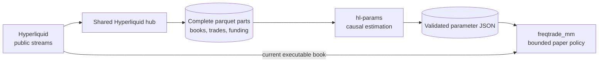

# Avellaneda–Stoikov Market Making

**An inventory-constrained research strategy for Hyperliquid perpetuals, running in Freqtrade.**

The bot alternates between flat and one long position. A public-data collector supplies order books, trades and funding observations; a separate process estimates the model inputs. The strategy and event replay share one quote implementation.

| Market | Execution | Stake | Leverage | Maximum hold | Trial drawdown stop |
| :--- | :--- | :--- | :--- | :--- | :--- |
| `MNT/USDC:USDC` (since 2026-11-08; PAXG before) | Paper only | Up to 50 USDC | 1× | 30 minutes | **10 USDC** |

> [!IMPORTANT]
> This is an experiment, not a validated profitable strategy. Public trade crossings do not reveal our live queue position. The strategy refuses live mode, preserves its risk-stop state across restarts, and blocks entries when data or model inputs are invalid.

[Pipeline](#pipeline) · [Model](#model) · [Estimation](#estimation) · [Paper trial](#paper-trial) · [Validation](#validation) · [References](#references)

## Pipeline



| Component | Responsibility |
| :--- | :--- |
| Shared hub | Durable canonical Parquet publication; subscription health; market metadata and settled funding |
| `hl-params` | Five-second volatility forecasts, size-aware crossing calibration and an explicit validity gate |
| `freqtrade_mm` | Shared inventory policy, quantity/price checks, protective exits and persistent trial controls |
| `scripts/evaluate.py` | Chronological replay, execution/cost sensitivities and uncertainty reporting |

The bot and parameter service use one project-owned image; the shared hub owns its separate image. The reference runtime is **Freqtrade 2025.10**, with **CCXT 4.5.84** pinned because the older connector cannot parse current Hyperliquid market metadata.

## Model

### Reference: the A–S approximation

For symmetric arrivals and unit lots, the classical approximate reservation price and half-spread are

$$
\begin{aligned}
r_t &= s_t-q_t\gamma\sigma_{\mathrm{abs}}^2(T-t),\\
h_t &= \frac{\gamma\sigma_{\mathrm{abs}}^2(T-t)}{2}
      +\frac{1}{\gamma}\ln\!\left(1+\frac{\gamma}{k}\right).
\end{aligned}
$$

Positive inventory lowers the reservation price. Setting inventory to zero while holding a long position removes that response. The implementation below uses an explicit constrained control problem rather than tuning an inventory-free spread.

### Implemented objective

The policy maximizes expected terminal liquidation wealth, with an inventory-risk penalty:

$$
\max_{\pi}\;
\mathbb{E}\!\left[
X_T+q_TS_T-C_{\mathrm{liq}}(q_T)
-\frac{\gamma_{\$}}{2}\int_t^T q_u^2v_u\,du
\right].
$$

| Symbol | Meaning | Units |
| :--- | :--- | :--- |
| $s_t,S_t$ | Top-of-book midpoint | USDC per base unit |
| $X_t$ | Cash-flow ledger, including fees and funding | USDC |
| $q_t$ | Actual inventory, including partial fills | Base units |
| $v_t$ | Forecast price-variance rate | Squared price units per second |
| $C_{\mathrm{liq}}$ | Spread/depth cost and taker fee of selling the remaining position | USDC |
| $\gamma_{\$}$ | Explicit risk preference | Inverse USDC |
| $\delta$ | Quote distance from the reference mid | Price units |
| $A,k$ | Crossing intensity scale and distance decay | Inverse seconds, inverse price units |

The initial research coefficient is $\gamma_{\$}=2\;\mathrm{USDC}^{-1}$. It is a declared experiment setting, not a fitted market property. Cash, quantity and price units are kept consistent when the stake or asset denomination changes.

A small backward dynamic program considers **wait, passive quote and liquidation** actions on a 15-second decision grid. A completed Freqtrade trade locks re-entry until the end of the current 15-minute candle. The planning horizon is 30 minutes; an existing position's deadline also counts down from its first fill.

The reference mid and arrival coefficients are frozen within each planning calculation. Forecast variance evolves through the horizon. A partial fill is managed using its actual remaining quantity. These are receding-horizon approximations, not a claim of exact optimality in a live queue.

## Estimation

### Volatility

Prices are sampled every five seconds using only books received before each sample. A book older than two seconds cannot supply a fresh observation. Missing intervals remain missing; returns never bridge gaps.

The estimator is a one-hour-half-life EWMA of squared five-second log returns, giving a flat variance forecast. A Student-t GARCH(1,1) used until 2026-11 fitted persistence of about 1e-4 on these returns, so it added no usable clustering. At $\gamma=2$ and the 50 USDC stake, the risk term over a full 30-minute hold is about 2e-4 USDC, roughly 3 % of one maker fee, so the variance model barely moves a decision.

The model consumes cumulative forecast variance:

$$
V_t(h)=s_t^2\sum_{j=1}^{h/\Delta t}
\widehat{\operatorname{Var}}_t(r_{t+j}),
\qquad \Delta t=5\ \mathrm{s}.
$$

Daily-equivalent sigma is a reporting quantity. The stored forecast covers one hour so that a still-valid estimate can support a subsequent 30-minute planning horizon. Diagnostics include convergence, persistence, residual autocorrelation and the estimator/fallback reason.

### Size-aware crossing intensity

For every complete 15-second window, calibration measures the deepest quote crossed by enough recorded volume to fill the intended quantity. Trade fragmentation therefore does not create extra independent observations.

The fitted window-maximum distribution is

$$
P(D<d)=\exp\!\left[-A\Delta t\,e^{-kd}\right].
$$

An interval-censored likelihood counts each window once. Bid and ask fits are separate. Quotes are restricted to the empirically supported distance range; the outer boundary needs at least 20 supporting crossings. Optional uncertainty estimates use circular blocks of 120 accepted windows: nominally 30 minutes, longer when capture gaps have been excluded. The offline evaluator skips this intensity bootstrap during its repeated fits.

### Post-fill markout

The same windows measure adverse selection. For each calibration distance, the markout is the mean mid change from the window start to the next decision, over the windows whose crossing went deeper than that distance:

$$
m_{\mathrm{bid}}(\delta)=E\!\left[S_{t+15\,\mathrm{s}}-S_t \mid D_{\mathrm{bid}}>\delta\right],\qquad
m_{\mathrm{ask}}(\delta)=-E\!\left[S_{t+15\,\mathrm{s}}-S_t \mid D_{\mathrm{ask}}>\delta\right].
$$

A fill is valued as $q(\delta+m(\delta))-f_m q P$ instead of $q\delta-f_m q P$, with linear interpolation between distances. For asks, a zero unconditional drift lets the no-fill branch keep the frozen mid. A distance with fewer than 20 observed moves is unsupported and caps the quote range. On PAXG (2026-11-07) $m$ was −0.12 to −0.36 USDC at 0.1–0.5 USDC, so every fill lost 1.0–1.7 bp after the 0.61 USDC-per-unit maker fee. That range already blocks entries on fees alone; the markout widens the loss and pulls exit asks toward the mid, where fills are less adversely selected. This public-crossing proxy excludes fills at exactly our price, and replayed queue fills showed larger adverse moves.

This estimates a **full-quantity public crossing proxy**. It does not estimate an authenticated order's queue position.

### Entry requirements

The default calculation uses a trailing 24-hour window and requires:

- At least six hours of data.
- At least 90% usable book and quote-exposure coverage.
- At least 1,000 exposure windows and 30 crossing windows per side.
- Known market precision/fees, recent funding context and healthy collection.
- Finite, correctly typed parameters and a valid UTC chronology.

A failed calculation publishes a disabled result. The bot rechecks inputs at entry confirmation; a missing or invalid update cannot leave a cached entry permission active.

Bad historical clocks are counted and excluded from usable observations and affected quote-exposure windows. They never become zero-crossing observations. The 90% coverage requirements still apply; an invalid latest book blocks entry.

There is **one current parameter format**, with no schema version or compatibility layer. Files are named `avellaneda_parameters_{TICKER}.json`. Valid historical parameter snapshots and timestamped market metadata are retained for chronological research.

`data_valid` describes input/model validity. `trade_enabled` additionally requires accepted historical evidence. The isolated trial explicitly enables `paper_evaluation`: simulated entries may be studied while profitability remains inconclusive, but data checks and risk stops cannot be bypassed.

## Paper trial

### Controls

| Control | Behaviour |
| :--- | :--- |
| Position stop | Exit at a net liquidation loss of 1% of filled entry notional |
| Holding deadline | Exit after 30 minutes from the first fill |
| Drawdown stop | Cancel entries and flatten at 10 USDC below observed peak liquidation equity |
| Trial duration | `avellaneda.trial_days` after valid data/model warm-up (default seven); `null` runs a continuous dry run with the other stops intact |
| Restart | Restore the deadline, peak equity and stop latch; never reset accumulated losses |
| Invalid data | Block entries and continue protective position management |

These are trigger thresholds, not guaranteed execution bounds. Outages, gaps and execution delay can cause overshoot.

Normal orders are GTC; the adapter does not guarantee post-only execution. Native price-stop/emergency orders use market execution. Net-loss, deadline and drawdown exits use aggressive reduce-only limits at executable bid depth, then continue managing any residual.

The shared policy defaults are defined in `scripts/quote_model.py`. Changing experiment settings requires reevaluation; the 50-USDC stake must also match `stake_amount` in the Freqtrade configuration.

### Start

Create a gitignored `.env` with fresh API-server credentials:

```dotenv
FREQTRADE__API_SERVER__USERNAME=<user>
FREQTRADE__API_SERVER__PASSWORD=<non-numeric-password>
FREQTRADE__API_SERVER__JWT_SECRET_KEY=<new-random-secret>
```

Then run from the repository root:

```bash
docker compose -p avellaneda-paper -f docker-compose.yml -f compose.paper.yml config --quiet
docker compose -p avellaneda-paper -f docker-compose.yml -f compose.paper.yml build freqtrade_mm
docker compose -p avellaneda-paper -f docker-compose.yml -f compose.paper.yml up -d
docker compose -p avellaneda-paper -f docker-compose.yml -f compose.paper.yml logs -f
```

The API is bound to **127.0.0.1:3004**. Runtime files are isolated under `runtime/paper/`:

```text
runtime/paper/
├── market-data/       # Frozen legacy capture; new data is in the central hub
├── params/            # Current results and valid historical snapshots
└── state/             # Paper database, trial.json and Freqtrade logs
```

`trial.json` reports the current state and blocking reason. `waiting_for_valid_data` is expected during warm-up. An elapsed six hours alone does not authorize an entry: coverage, crossing counts, model validity and the chosen action must also qualify.

Read Freqtrade's native PnL summary using the bot's existing API credentials:

```bash
docker compose -p avellaneda-paper -f docker-compose.yml -f compose.paper.yml exec -T freqtrade_mm python /freqtrade/scripts/show_pnl.py
```

These framework metrics differ from the executable liquidation equity used by the risk stop in `trial.json`.

The paper Compose override is separate from the default `runtime/main/` paths. Existing historical databases are not reused or reset. CPU and API-rate limits on a shared host remain managed by the workspace's central tooling.

### Collectors and data locations

Since 2026-10-09 there is one active tick archive, owned by the shared Hyperliquid
hub. The parameter service and new replays use its canonical data through the
shared Python reader; projection happens in memory and writes no second archive.

| Location | Purpose |
| :--- | :--- |
| `../HYPERLIQUID_DATA/data/hub/` | Canonical fast/slow books, BBO, trades, context, funding and metadata; mounted read-only at `/freqtrade/central-data` |
| `../HYPERLIQUID_DATA/hub/hl_reader.py` | Shared reader; honors column selection so a top-of-book estimate does not expand all 20 levels |
| `runtime/paper/params/` | Current estimates and historical parameter snapshots |
| `runtime/paper/validation/` | Saved reports, replay ledgers and parameter schedules |
| `runtime/paper/market-data/` | Frozen local archive used by older saved sweeps |
| `../HYPERLIQUID_DATA/data/eth_mm/` | Frozen shared legacy archive; preserved in its original layout |

`hl-collector` is stopped and behind the `legacy-archive` profile. Default startup
runs only the bot and parameter service. Start the central hub first. Old data is
retained; a different path does not imply another active collector. For new
replays, use `--data-dir /freqtrade/central-data`. Reproducing an older saved sweep
requires explicitly mounting and selecting its original historical input.

The hub keeps fast (up to five levels) and slow (up to twenty levels) books
separate, retains both exchange and receipt clocks, and identifies trades by
coin, exchange time and trade ID. Missing periods are not backfilled. Keep raw
archives and private research outputs local and gitignored.

### Connection loss and PC restarts

The shared hub reconnects and resubscribes its separate fast and slow feeds after disconnects. Fresh observations and subscription acknowledgements are required after recovery. Failed parameter calculations retry after one minute; valid estimates retain the fifteen-minute schedule.

Docker's `unless-stopped` policy restores the services when its engine restarts. On Windows, enable [Start Docker Desktop when you sign in](https://docs.docker.com/desktop/settings-and-maintenance/settings/); recovery then occurs after Windows sign-in, not before it. Containers deliberately stopped with `docker compose stop` remain stopped until started again.

SQLite trades/orders, first-fill deadlines, trial start, peak equity and stop latches survive in `runtime/paper/state/`. Restarting does not grant a new risk budget or holding period. The central hub normally fsyncs its WAL once per second; abrupt power loss can lose that uncommitted tail. Durable pending batches survive publication failures and restart. Missing intervals remain gaps subject to the coverage checks.

## Validation

Run the focused checks in the same image:

```bash
docker compose -p avellaneda-paper -f docker-compose.yml -f compose.paper.yml \
  run --rm --no-deps --entrypoint python hl-params /freqtrade/scripts/check_pipeline.py
```

Checks include synthetic parameter recovery, future-data invariance, post-only entry rejection, an independently enumerated small control problem, denomination scaling, Freqtrade's candle lock, partial fills, cancellation races, terminal losses, rejected parameter updates, persistent stops, SQLite order/deadline restoration, reconnects and parquet failure recovery.

For a diagnostic calculation, write to a separate directory so it cannot race the running parameter service:

```bash
docker compose -p avellaneda-paper -f docker-compose.yml -f compose.paper.yml \
  run --rm --no-deps --entrypoint python hl-params \
  /freqtrade/scripts/calculate_avellaneda_parameters.py PAXG --output-dir /freqtrade/params/diagnostics
```

`scripts/verify_effective_price.py` reads a captured book file or parquet directory through the production loader and summarizes bid, ask and midpoint prices; `--start` and `--end` accept timezone-aware timestamps.

For a chronological replay, replace the example dates with an interval having a preceding calibration history:

```bash
docker compose -p avellaneda-paper -f docker-compose.yml -f compose.paper.yml \
  run --rm --no-deps --entrypoint python hl-params \
  /freqtrade/scripts/evaluate.py PAXG --data-dir /freqtrade/central-data \
  --start 2026-10-03T00:00:00Z --end 2026-10-10T00:00:00Z \
  --output /freqtrade/params/evaluation
```

The evaluator refits using preceding observations, liquidates at daily boundaries, and reports base/zero/five-second latency cases, higher fees, all-taker costs, a fixed-quote baseline and no trading. Each day resets inventory and simulated risk state; the paper run tracks the continuous seven-day budget. The evaluator saves JSON ledgers, an evidence summary and a diagnostic figure.

Offline studies can opt into `gap_aware=True` in the shared estimator and replay.
Calibration then uses complete observed windows, requiring six observed hours;
missing prices never create returns or zero-crossing observations. Replay pauses
entries on stale data or rejected clocks, cancels through the normal latency path,
and liquidates affected inventory when fresh books return. It retains subsequent
complete cycles while labeling exposed gaps and missing funding as uncertain.
`observable_pnl` describes those observed cycles, not an unbiased continuous-account
return: missing fills can change inventory, and missingness may depend on activity.
Full-run validity remains false when exposure was uncertain. The running paper
estimator and strategy retain their default 90% coverage gate.

The quote recursion uses one Numba kernel shared by the bot and replay, with strict
floating-point arithmetic (`fastmath=False`) and no parallel execution. Validation,
timestamps and accounting remain in Python. Replay prepares column arrays and static
events once per interval, then gives each scenario its own event heap and order state.

On a captured 2.5-hour PAXG interval (16,632 books, 629 trades), five interleaved runs
gave these median times, excluding file loading, estimation and first compilation:

| Implementation | Replay time |
| :--- | ---: |
| Original Python | 4.08 s |
| Array preparation, original quote solver | 2.51 s |
| Arrays and Numba | 0.78 s |
| Numba with prepared events reused | 0.30 s |

Loading took 1.94 s; first kernel compilation took 3.04 s in the unrestricted research
container. These are local measurements, not guarantees under the paper CPU quota.
All ten saved gamma/latency scenarios retained identical fill/accounting ledgers.

The bot warms the kernel before managing orders. `NUMBA_CACHE_DIR` points to
`/freqtrade/state/numba_cache` for the bot and `/freqtrade/params/numba_cache` for
research through the parameter service. These writable, gitignored host volumes
preserve compilation caches across restarts; changing code can require recompilation.
Keep the matching cache warm before restarting a bot with an existing position.
Under the paper limits (0.1 CPU, 512 MiB), the isolated bot-import/warm-up check took
59.1 s with a fresh cache and 34.3 s with a cached kernel; peak RSS was 408 and 366 MiB.
These times exclude exchange initialization. They do not describe quote/network latency.

`scripts/benchmark_replay.py` reproduces the timing/parity comparison in Docker.
It takes `--data-dir`, `--schedule` (saved causal parameter publications),
`--reference-dir` (pre-optimization `backtest.py`, `quote_model.py`, `utils.py`),
`--start`, `--end`, and `--output`; `--repeats` defaults to five. Use a fresh writable
`NUMBA_CACHE_DIR` to measure cold compilation. The report separates loading,
preparation, first/warm kernel calls and replay timings, and records peak process RSS.

The replay estimates queue position using the conservative approach in
[hftbacktest's `RiskAdverseQueueModel`](https://github.com/nkaz001/hftbacktest/blob/master/hftbacktest/src/backtest/models/queue.rs).
At exchange acceptance, an order joins behind the displayed size at its price.
Same-price trades consume that size before partially filling our order. New volume
joins behind us; a smaller snapshot caps the ahead estimate but never generates a
fill by itself. Same-timestamp prints precede snapshot adjustments to avoid counting
the same depletion twice. Cancellation leaves the order exposed until acknowledgement,
and replacement loses priority. Beyond the captured depth, the queue remains unknown:
same-price prints cannot fill it until depth is observed or a trade goes through the
quote. Through-print fills remain capped by observed trade volume, unlike hftbacktest's
full-fill assumption. This is a small-order approximation with no market impact or
fitted cancellation probabilities. Risk decisions use received books; exchange-side
fills and terminal liquidation use exchange books.

The normal evidence gate requires seven complete out-of-sample days, 100 completed round trips and positive one-sided 95% block-bootstrap lower bounds for base and five-second latency scenarios. Two-day-block sensitivity must also remain positive. Missing observations or insufficient samples remain **inconclusive**.

### Remaining scientific limits

- Public-trade replay and Freqtrade dry-run have different fill mechanisms. Neither validates live queue position.
- Five-level snapshots cannot reveal exact FIFO priority. Order latency is fixed, fill acknowledgements are immediate, and the replay does not reproduce every Freqtrade entry-veto/timeout path. Queue estimates require calibration against actual executions before relying on small parameter differences.
- The binary full-fill arrival model approximates a market with partial execution; the ledger still accounts for actual simulated partial quantities.
- A finite, fixed reference price within the control calculation omits predictive drift. Adverse selection enters only as the measured 15-second markout per fill; later continuation is assumed to be zero. Replay records 1–60 s markouts to test that assumption.
- Funding marks use the observed mark when available, otherwise the contemporaneous book midpoint as a valuation proxy.
- Quote search is capped at 512 tick candidates for unusually wide fitted ranges.
- Synthetic agreement, a healthy process or a short positive run does not establish a trading edge.

## References

| Resource | Relevant material |
| :--- | :--- |
| [Avellaneda & Stoikov (2008)](https://math.nyu.edu/inmemoriam/avellaneda/HighFrequencyTrading.pdf) | Reservation prices and approximate spreads |
| [Guéant, Lehalle & Fernandez-Tapia](https://arxiv.org/abs/1105.3115) | Inventory constraints and finite-horizon control |
| Cartea, Jaimungal & Penalva, *Algorithmic and High-Frequency Trading*, Chapter 10 | Running inventory penalties, liquidation and adverse selection |
| López de Prado, *Advances in Financial Machine Learning*, Chapters 7, 11 and 12 | Leakage, selection bias and chronological evaluation |
| Jansen, *Machine Learning for Algorithmic Trading*, Chapter 9 | Volatility modelling |
| [Hyperliquid fees](https://hyperliquid.gitbook.io/hyperliquid-docs/trading/fees) and [funding](https://hyperliquid.gitbook.io/hyperliquid-docs/trading/funding) | Cost assumptions |

The [Francesco Mangia notebook](scripts/Francesco_Mangia_Avellaneda_BTC.ipynb) is retained as a historical reference with its original code and notes. It uses external datasets and different execution assumptions; its conclusions are not validation of this implementation. Cached execution outputs have been removed.

## Support

[Hyperliquid referral link](https://app.hyperliquid.xyz/join/FREQTRADE) — supports the project; current eligibility and discounts follow Hyperliquid's terms.

## Disclaimer

This project is for research and education. Market making can lose money through price moves, adverse selection, costs and execution failures. Historical and synthetic results do not establish future profitability.
